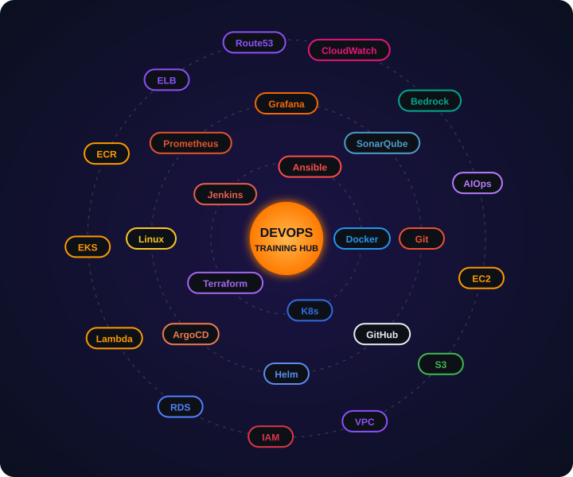

# VishnuMangiras
<h1 align="center">Hi 👋, I'm Vishnu Teja Mangira</h1>
<h3 align="center">🚀 DevOps Engineer | AWS Cloud ☁️ | Kubernetes ☸️ | Docker 🐳 | Terraform 🌍 | CI/CD 🔄</h3>

  

---

<h2 align="center">🌌 My DevOps Technology Universe</h2>

  

---

## 👨‍💻 About Me
- 💼 DevOps Engineer with 3+ years of experience in Cloud & Automation  
- ☁️ Hands-on experience with AWS Cloud (EC2, S3, VPC, IAM)  
- 🔧 Expertise in CI/CD pipelines, Infrastructure as Code & Containerization  
- 🚀 Passionate about building scalable and reliable systems  
- 📍 Bengaluru, India  

---

## 🔧 Skills & Tools

| Category | Technologies |
|----------|-------------|
| ☁️ Cloud | AWS (EC2, S3, VPC, IAM) |
| 🔁 CI/CD | Jenkins, GitHub Actions |
| 🐳 Containers | Docker, Kubernetes, Helm |
| 🌍 IaC | Terraform |
| 🤖 Automation | Ansible, Shell Scripting |
| 🔧 Version Control | Git, GitHub, GitLab |
| 🐧 OS | Linux |
| 📊 Monitoring | Prometheus, Grafana |

---

## 🚀 Projects

### 🔹 End-to-End DevOps Pipeline
- Built CI/CD pipeline using Jenkins  
- Integrated Docker & Kubernetes deployment  
- Automated build, test & deployment process  

### 🔹 AWS Infrastructure using Terraform
- Designed VPC, EC2, IAM using Terraform  
- Implemented modular infrastructure  
- Automated provisioning of resources  

### 🔹 Docker & Kubernetes Deployment
- Containerized applications using Docker  
- Deployed applications using Kubernetes  
- Configured services, deployments & scaling  

---

## ⚙️ What I Do
- Automate infrastructure using Terraform  
- Build CI/CD pipelines using Jenkins  
- Deploy scalable applications using Kubernetes  
- Manage cloud environments in AWS  

---

## 📊 GitHub Stats

  

  

  

---

## 📫 Connect with Me
- 💼 LinkedIn: https://www.linkedin.com/in/mangira-vishnu-teja/  
- 📧 Email: vishnumangira571@gmail.com  

---

## 🎯 Goals
- 🚀 Become a highly skilled DevOps Engineer  
- ☁️ Master AWS & Cloud Architecture  
- 🔥 Build scalable, secure and automated systems  

---
